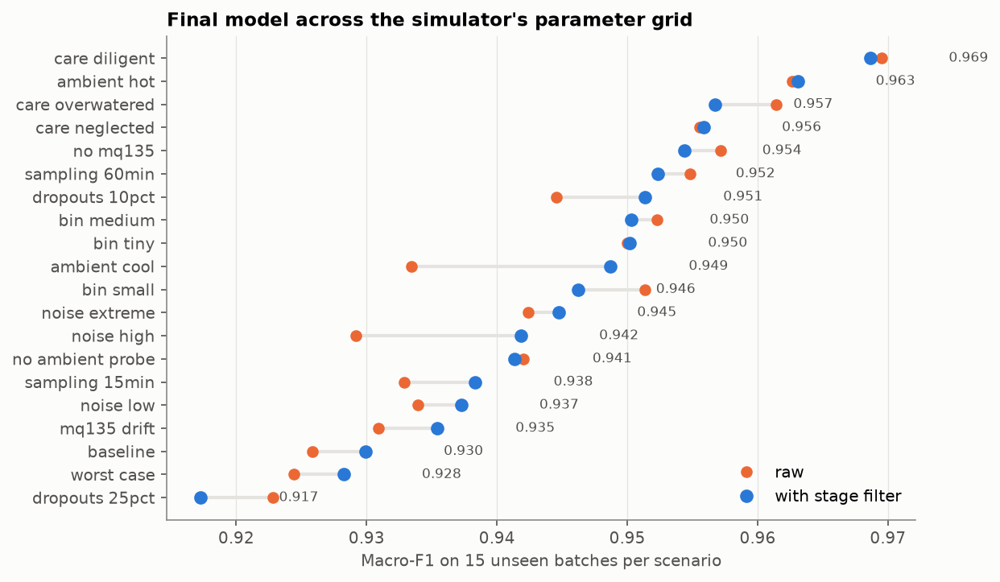
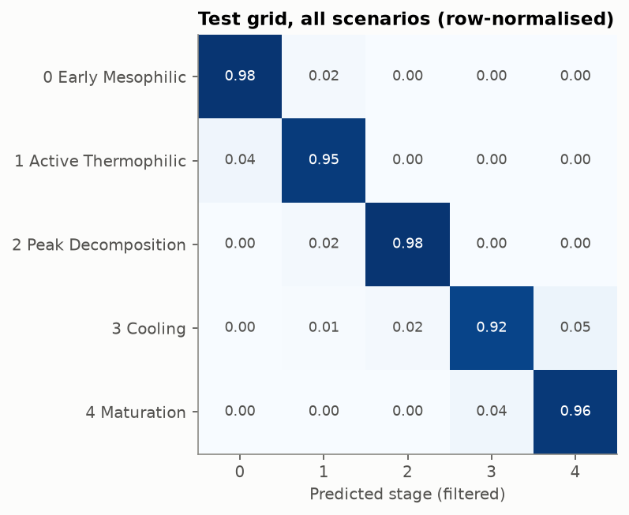
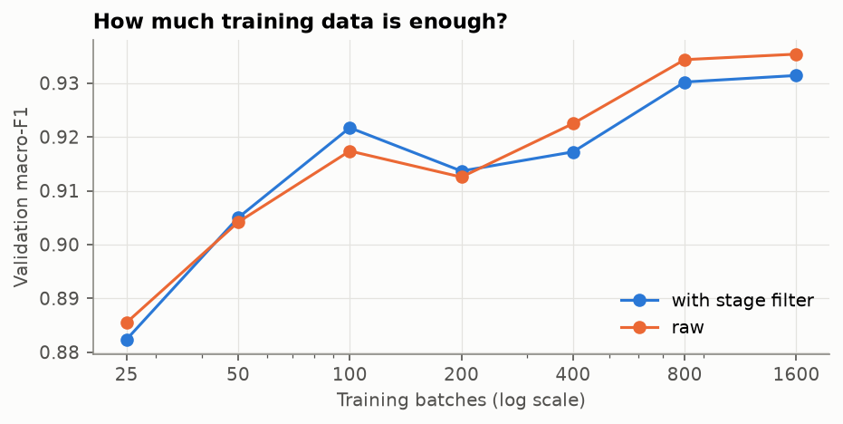

# Compost stage classifier — training report

Generated by `ml/train.py` on 2026-10-18T02:38:43Z (scikit-learn 1.9.1, 6 min). Re-run it to reproduce; every number comes from `model_card.json`.

## Final model

- **Gradient boosting** (`HistGradientBoostingClassifier`, balanced class weights): lr 0.1, 63 leaves, 48 trees (chosen by early stopping on the validation batches, then refit on train + validation). Settings `{"learning_rate": 0.1, "max_iter": 48, "max_leaf_nodes": 63, "min_samples_leaf": 20, "l2_regularization": 0.0, "every_h": 1}`
- **Features:** core + moisture + ambient (20 features, see `ml/features.py`)
- **Stage filter:** forward-only HMM, speed 8, stage 1 → Cooling skip share 0.9
- **Trained on:** train + validation, 1000 simulated batches (1,295,608 hourly rows)
- **Test grid (all 300 batches):** macro-F1 **0.946** with the filter (0.944 raw), balanced accuracy 0.959, accuracy 0.955

## Test grid: one simulator setting changed at a time

Each scenario is 15 batches the model never saw, with one setting moved away from the baseline (ambient 26–30 °C, full-size bin, irregular care, normal noise, 30-minute readings, 2 % dropouts, a calibrated MQ-135 and an ambient probe). `worst_case` changes five at once.

| scenario | batches | raw | filtered | filtered accuracy |
|---|---|---|---|---|
| ambient_cool | 15 | 0.933 | 0.949 | 0.973 |
| ambient_hot | 15 | 0.963 | 0.963 | 0.976 |
| baseline | 15 | 0.926 | 0.930 | 0.935 |
| bin_medium | 15 | 0.952 | 0.950 | 0.959 |
| bin_small | 15 | 0.951 | 0.946 | 0.963 |
| bin_tiny | 15 | 0.950 | 0.950 | 0.967 |
| care_diligent | 15 | 0.970 | 0.969 | 0.982 |
| care_neglected | 15 | 0.956 | 0.956 | 0.982 |
| care_overwatered | 15 | 0.961 | 0.957 | 0.979 |
| dropouts_10pct | 15 | 0.945 | 0.951 | 0.952 |
| dropouts_25pct | 15 | 0.923 | 0.917 | 0.885 |
| mq135_drift | 15 | 0.931 | 0.935 | 0.943 |
| no_ambient_probe | 15 | 0.942 | 0.941 | 0.934 |
| no_mq135 | 15 | 0.957 | 0.954 | 0.965 |
| noise_extreme | 15 | 0.942 | 0.945 | 0.970 |
| noise_high | 15 | 0.929 | 0.942 | 0.942 |
| noise_low | 15 | 0.934 | 0.937 | 0.960 |
| sampling_15min | 15 | 0.933 | 0.938 | 0.933 |
| sampling_60min | 15 | 0.955 | 0.952 | 0.961 |
| worst_case | 15 | 0.924 | 0.928 | 0.956 |

## Iterations (validation set: 200 batches from the training distribution)

Every fit below stops early once the validation batches' log loss stops improving (15 rounds). An earlier version used a fixed 300 trees: the model kept going past its best point, its probabilities saturated, and with 1,600 training batches it collapsed from 0.93 to 0.80 macro-F1.

### 1. Feature sets (quick model, every 2nd hour)

| feature set | features | trees | raw | filtered |
|---|---|---|---|---|
| core probe + moisture | 15 | 33 | 0.926 | 0.924 |
| scale-free | 10 | 31 | 0.858 | 0.858 |
| core + moisture + ambient | 20 | 36 | 0.930 | 0.927 |
| all hardware (+ scale-free) | 25 | 33 | 0.929 | 0.925 |
| all hardware + MQ-135 | 28 | 34 | 0.928 | 0.927 |
| + simulated O2/CO2/NH3 | 31 | 30 | 0.933 | 0.928 |

### 2. Gradient boosting settings

| settings | trees | raw | filtered | fit seconds |
|---|---|---|---|---|
| lr 0.1, 31 leaves | 49 | 0.930 | 0.924 | 15 |
| lr 0.05, 31 leaves | 83 | 0.931 | 0.925 | 27 |
| lr 0.1, 63 leaves | 48 | 0.934 | 0.930 | 22 |
| lr 0.1, 15 leaves | 64 | 0.926 | 0.921 | 16 |
| lr 0.1, 31 leaves, 200 rows per leaf, l2 1.0 | 53 | 0.929 | 0.923 | 18 |
| lr 0.1, 31 leaves, every 2nd hour | 49 | 0.932 | 0.927 | 12 |
| lr 0.1, 31 leaves, every 3rd hour | 57 | 0.932 | 0.927 | 13 |

### 3. Learning curve

| training batches | hourly rows | trees | raw | filtered |
|---|---|---|---|---|
| 25 | 34,061 | 40 | 0.885 | 0.882 |
| 50 | 65,524 | 43 | 0.904 | 0.905 |
| 100 | 128,015 | 43 | 0.917 | 0.922 |
| 200 | 255,046 | 44 | 0.913 | 0.914 |
| 400 | 509,593 | 42 | 0.922 | 0.917 |
| 800 | 1,030,991 | 48 | 0.934 | 0.930 |
| 1600 | 2,069,045 | 56 | 0.935 | 0.931 |

### 4. Stage filter: how fast stages may advance, and how often stage 1 skips straight to Cooling

| filter | speed | skip share | filtered |
|---|---|---|---|
| speed 1, skip 0.2 | 1.000 | 0.200 | 0.930 |
| speed 1, skip 0.4 | 1.000 | 0.400 | 0.930 |
| speed 1, skip 0.6 | 1.000 | 0.600 | 0.930 |
| speed 1, skip 0.8 | 1.000 | 0.800 | 0.930 |
| speed 1, skip 0.9 | 1.000 | 0.900 | 0.930 |
| speed 2, skip 0.2 | 2.000 | 0.200 | 0.931 |
| speed 2, skip 0.4 | 2.000 | 0.400 | 0.931 |
| speed 2, skip 0.6 | 2.000 | 0.600 | 0.931 |
| speed 2, skip 0.8 | 2.000 | 0.800 | 0.932 |
| speed 2, skip 0.9 | 2.000 | 0.900 | 0.931 |
| speed 4, skip 0.2 | 4.000 | 0.200 | 0.932 |
| speed 4, skip 0.4 | 4.000 | 0.400 | 0.933 |
| speed 4, skip 0.6 | 4.000 | 0.600 | 0.933 |
| speed 4, skip 0.8 | 4.000 | 0.800 | 0.933 |
| speed 4, skip 0.9 | 4.000 | 0.900 | 0.933 |
| speed 8, skip 0.2 | 8.000 | 0.200 | 0.934 |
| speed 8, skip 0.4 | 8.000 | 0.400 | 0.934 |
| speed 8, skip 0.6 | 8.000 | 0.600 | 0.934 |
| speed 8, skip 0.8 | 8.000 | 0.800 | 0.934 |
| speed 8, skip 0.9 | 8.000 | 0.900 | 0.934 |

## Files

- `compost_stage_gb.joblib`: the model bundle (`predict.py` loads it)
- `model_card.json`: settings, data hashes and every score above
- `test_grid_predictions.csv.gz`: per-hour predictions on the test grid
